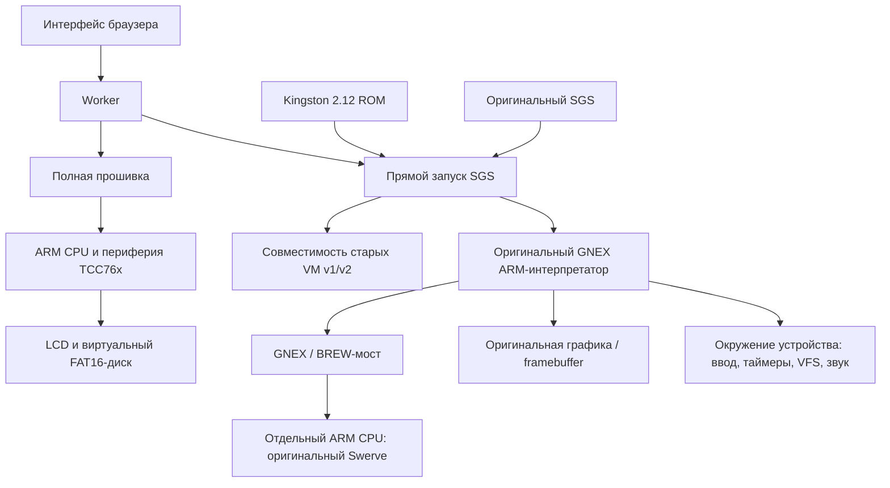

# Архитектура Reunion

Reunion содержит два независимо развиваемых исполнения: веб-ядро на JavaScript
и настольную модель на Python. Они используют Unicorn для ARM-инструкций и
сверяются на общих сценариях K-PEX. У Python-версии более узкая телефонная
совместимость; таблица веб-версии к ней не применяется автоматически.

## Два пути исполнения

В **прямом режиме SGS** модель загружает необходимые части Kingston 2.12 в
окружение GNEX. Это ускоряет запуск игр без загрузки оболочки плеера. Веб-ядро
дополняет телефонные системные функции, размеры экрана, клавиши, таймеры,
хранилище и звук. Для старых SGS v1/v2 отдельно реализованы их формат и VM.
Ресурсы и игровой байткод остаются исходными.

В **полном режиме** CPU начинает с точки сброса. Оригинальная прошивка
инициализирует периферию, читает ресурсы и SGS с виртуального накопителя и
рисует в LCD. Это другой путь ввода, файлового доступа и звука. Его ограничения
перечислены в [аппаратной модели](hardware.md).

Быстрые состояния восстанавливают действительно достигнутые память,
регистры и периферию полной машины. Три состояния входят в коллекцию вместе
с оригинальными ROM/SGS; все они проверяются по размерам и SHA-256.

## Основные модули веб-версии

| Модуль                                                | Ответственность                                                     |
| ----------------------------------------------------- | ------------------------------------------------------------------- |
| `web/app.js`                                          | Интерфейс, ввод пользователя, кадры и Web Audio                     |
| `web/worker.js`                                       | Управление исполнением отдельно от UI, сообщения, шаг и пауза       |
| `web/storage.js`                                      | Локальное браузерное хранилище                                      |
| `web/engine/cpu.js`                                   | Адаптер Unicorn ARM/WASM                                            |
| `web/engine/firmware.js`                              | Полная машина TCC76x                                                |
| `web/engine/gnex.js`                                  | Прямой GNEX-режим и системные функции                               |
| `web/engine/rom-accelerators.js`                      | Проверенная замена цикла очистки RGB565 с сохранением состояния ARM |
| `web/engine/legacy.js`                                | Старые SGS v1/v2                                                    |
| `web/engine/sgs.js`                                   | Разбор контейнеров SGS и ресурсов                                   |
| `web/engine/vfs.js`, `disk.js`                        | Файлы приложения и виртуальный диск полной прошивки                 |
| `web/engine/timers.js`                                | Три таймера GNEX с виртуальными сроками                             |
| `web/engine/swerve.js`, `m3g-native.js`, `m3g-api.js` | GNEX/BREW-мост и исполнение оригинального 3D-движка                 |
| `web/smaf-worker.js`, `smaf-decoder.js`               | Отдельное декодирование SMAF в WASM                                 |

Веб-CPU использует **Unicorn.js ARM 1.0.3**, Python — зависимость **Unicorn 2.1.4**.
Версии нельзя механически уравнивать: сохранены проверенная браузерная сборка,
её хеши и соответствующие исходники. Для вложенных GNEX → Swerve вызовов нужны
два отдельных WASM-экземпляра; совместное использование старого модуля
повреждает контекст внешнего CPU. Это закреплено тестом изоляции.

Обычные игровые события используют ограничение работы по блокам и проверенную
функцию ускорения RGB565. Для SGS v36 ход времени GNEX сохраняется через
проверочный режим VM, ускоряется вложенный Swerve. Явные бюджеты инструкций
и полная аппаратная модель сохраняют точную остановку.
[Подробности и дифференциальные проверки](web-performance.md).

## Данные и повторяемость

`web/data/catalog.json` хранит имена, размеры, SHA-256 и проверенные профили.
Распознавание файла по имени недостаточно: разные сборки одной игры могут
иметь разные требования. Синтетические MIN/UserID задают окружение
виртуального устройства и не относятся к реальным абонентам.

Сохранения разделены по приложению. Гостевой путь VFS не становится путём
файловой системы хоста. Приложенные к SGS файлы остаются исходными;
сохранения и NV хранятся отдельно. Исторические сетевые запросы не создают
автоматических переходов в операторские магазины.

Для диагностики используйте [replay-sgs](replay.md): фиксированные действия,
виртуальные таймеры, счётчики и хеши framebuffer позволяют воспроизвести
конкретную ошибку. Нативные эталоны K-PEX и сохранённые сценарии в `validation/`
служат разными видами доказательств: точное совпадение кадра не заменяет
проверку долгой игровой сессии, а отсутствие исключения не доказывает
правильный кадр.
